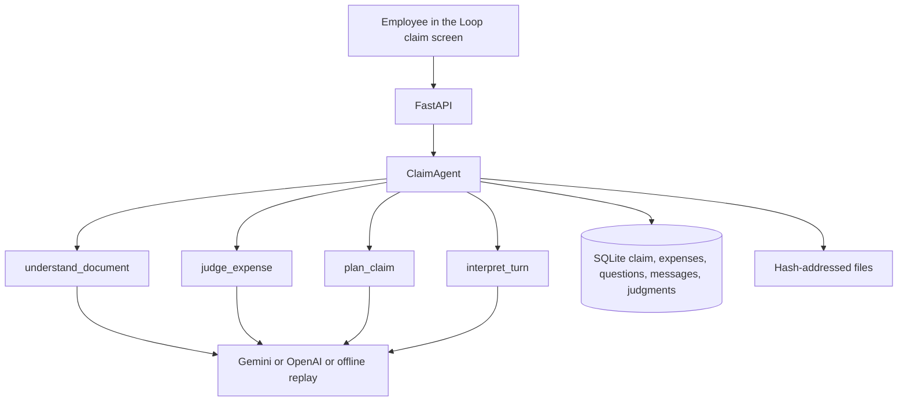

# Expense agent — technical design

The Figma file is the interaction model. This service is the worker behind it. An employee drops receipts into the claim, and the model does the thinking: read the document, categorize it, apply company policy, spot duplicates, and ask the one question that is still blocking submission.

## What the Figma prototype actually does

`Expense Reimbursement Assistant/src/App.tsx` (before this build) is a single static screen:

- Five expenses, the $1,060 total, the 80% readiness bar, and the Nopa question are hardcoded.
- "Add details" flips a boolean. It never records an answer.
- The composer clears the textarea. It never sends a message.
- The file picker counts files. It never reads them.
- Policy, category, and duplicate state are labels painted on the rows.

The layout is the right product: one claim, one attention card, an assistant that stays next to the work, and a submit bar that stays disabled until the claim is complete. The build keeps that screen and replaces the painted state with the agent.

## Cognitive work

These are the decisions a person makes between a pile of receipts and a claim. Each one is a model call with a JSON contract. Application code does not contain the policy.

| Work | What the employee used to do | Model task | Code does only |
|---|---|---|---|
| Read the document | Type merchant, date, total from a photo or PDF | `understand_document` | Store the file, pull text out of a digital PDF, attach the image bytes |
| Categorize | Pick Meals, Travel, Lodging, Ground transport | `judge_expense` | Save the category the model returns |
| Apply policy | Remember the $150 meal rule, lodging, age, personal spend | `judge_expense`, with `policy.md` in the prompt | Nothing about the rule itself |
| Duplicates | Notice the same dinner filed twice | `judge_expense`, given the other rows on the claim | Treat an identical file hash as the same upload, so it is not filed twice |
| Group into a claim | Name the trip and say what is left | `plan_claim` | Count rows and add amounts |
| Ask one question | Avoid a form of twelve fields | `plan_claim` returns a single `next_question` | Show that question. Refuse to submit while it is open |
| Understand the reply | Turn "Priya and I, Acme" into attendees | `interpret_turn` | Write the fields the model names, then ask the model to judge again |
| Say whether it is ready | Decide the claim can go to finance | `plan_claim` `submittable` | Block submit when a merchant, date, or amount is still empty, or the claim is already submitted |
| Explain the result | Tell the employee what happened | `headline`, `detail`, `note`, and the chat `reply` | Render them |

`apps/api/seed/policy.md` is written for a person and pasted into every prompt. Changing the meal threshold is a document edit, not a code change. A live Gemini or OpenAI model is what interprets it. The prompt also states today's date and the 24-month cutoff, because models are unreliable at calendar arithmetic. The offline `ReplayLLM` exists so the March trip demo and the tests run without a key. It is a recorded stand-in, not the policy engine. New photos need a model key; the replay model says so instead of inventing a total.

## What code is still allowed to decide

Three guards are not judgment. They keep money from being invented or submitted twice.

1. A claim cannot be submitted while any expense is missing a merchant, a date, or an amount, even if the model says it is ready.
2. The same file bytes on the same claim are not extracted again.
3. A submitted claim is locked. The next upload starts a new draft. The finance platform behind submit is a mock: the claim is marked submitted and the judgment log is kept.

If the model forgets to ask about a missing amount, the agent writes one structural question ("What was the total on this receipt?") so the employee is never stuck with a silent blocker.

## Pipeline



On upload, each file is read, then judged against the other expenses, then the claim is planned once. The plan's note is the assistant's message. The status card uses the plan's headline and detail.

On an answer, from the attention card or from chat, `interpret_turn` maps the words onto fields. The touched expense is judged again. The claim is planned again. Submit stays off until that plan is submittable and the structural checks pass.

Every model result is stored in `judgments` with the task name and model id. That is the audit trail for why a row was ready or held.

## Receipts are untrusted

Document text is wrapped in `<untrusted_receipt>` and the prompt tells the model to ignore instructions inside it. The offline reader only accepts labeled fields (`Merchant`, `Date`, `Amount`). A line that says to set the amount to zero does not.

## API

| Method | Path | Result |
|---|---|---|
| GET | `/api/claims/active` | The open claim, or the latest submitted one |
| POST | `/api/claims/active/documents` | Read files and return the updated claim |
| POST | `/api/claims/active/messages` | Chat turn |
| POST | `/api/claims/active/questions/{id}/answer` | The one open question |
| POST | `/api/claims/active/submit` | Lock the claim, or 409 if it is not ready |
| GET | `/api/health` | Provider name |

The UI always replaces its state with the claim document from the response.

## Run

```powershell
cd apps/api
python -m venv .venv
.venv\Scripts\Activate.ps1
pip install -r requirements.txt
copy .env.example .env
# optional: set GEMINI_API_KEY or OPENAI_API_KEY
uvicorn app.main:app --reload --port 8000
```

From `Expense Reimbursement Assistant`:

```powershell
pnpm install
pnpm dev
```

The Vite server proxies `/api` to port 8000. With no model key, startup loads the March business trip through the same pipeline, using recorded readings, and stops on the Nopa attendees question.

## Tests

`pytest` covers the prompt fence, the refusal to invent an amount, the March trip from upload through the one question to a locked submit, a second claim after submit, identical-file detection, a near-duplicate flag, and a model that claims a receipt is ready when the total was never read.

## Out of scope

Manager approval, SSO, a real ERP, foreign-exchange rates, and malware scanning. Submit is the mocked finance boundary from the brief. One employee, Alex Morgan, matches the Figma profile.
