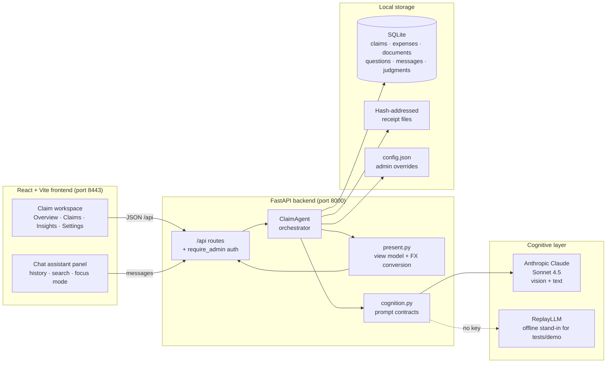
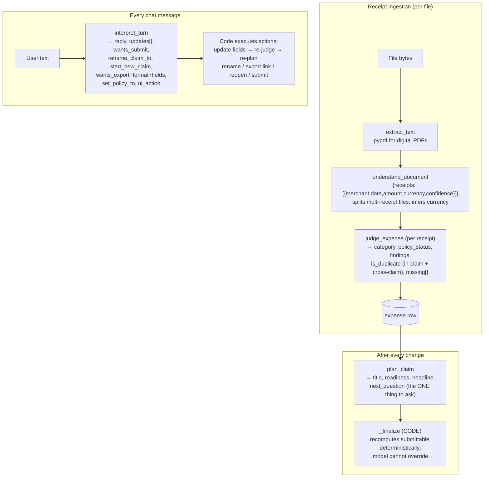
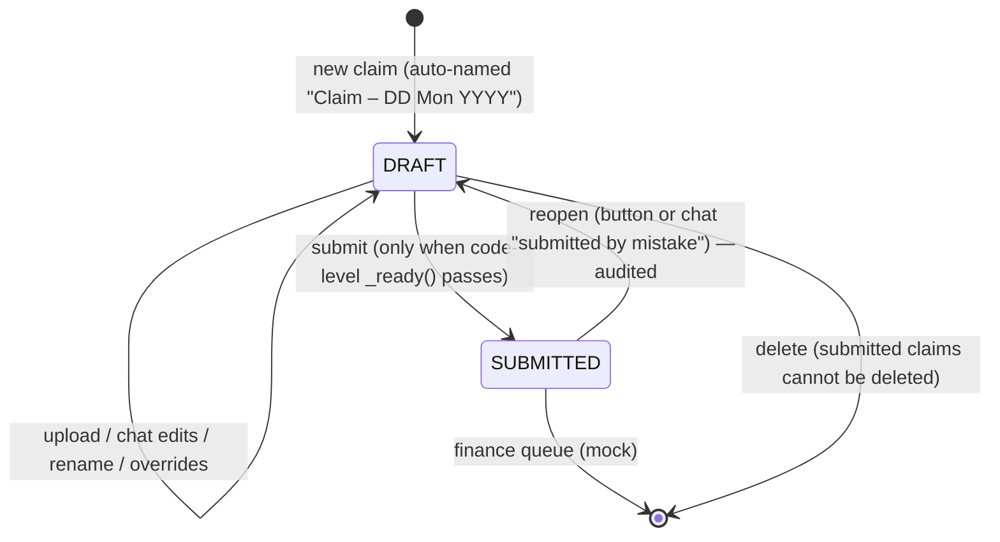

# JRCA — Jio Reimbursement Claims Assistant

**Technical Design Document · v0.1.0 · October 2026**

Repository: https://dev.azure.com/JioMobilityAndEnterprise/AI%20Initiatives/_git/JRCA

---

## 1. Project overview

### 1.1 Track

**Agentic AI / Enterprise Productivity** — an autonomous expense-processing agent that replaces form-filling with a conversation. The system belongs to the "AI agent as coworker" track: the LLM is not a chat bolt-on, it is the cognitive layer that reads documents, applies company policy, and drives the claim to completion, while deterministic code guards the money.

### 1.2 Problem

Expense reimbursement is high-friction, low-judgment work:

- Employees re-type merchant, date, and amount from piles of receipts — often many receipts scanned into a single PDF.
- Policy rules ("meals over a limit need attendees") live in a document nobody reads, enforced after the fact by finance.
- Duplicates, personal spends, and stale receipts leak through.
- Every policy change needs a software release in classic rule-engine systems.

### 1.3 Solution

JRCA lets an employee **drop any receipt artifact** — photos, native PDFs, scans, multi-receipt bundles, even bank statements — and the agent:

1. **Splits and reads** every distinct receipt in every file (vision + text).
2. **Categorizes** each expense and **judges it against the company policy**, which is a plain-language document interpreted by the model — not code.
3. **Flags duplicates** within the claim *and across all other claims*.
4. **Asks only the single most important question** that still blocks submission.
5. **Converses**: everything the screen offers can be done by chat — fix a date, rename the claim, export JSON for a finance system, query spend across claims, reopen a mistakenly submitted claim, or change the screen layout.
6. **Submits and locks** the claim with a full audit trail.

### 1.4 Key differentiators

| Capability | How JRCA does it |
|---|---|
| Multi-receipt files | Model decides how many distinct charges a document contains; each becomes its own expense row |
| Policy as prose | `policy.md` is pasted into every judgment prompt; admins edit text, not code |
| Chat-equals-UI | The `interpret_turn` task returns structured actions (field updates, rename, export, submit, reopen, layout) that the backend executes |
| Deterministic guardrails | Code — not the model — blocks submission without merchant/date/amount, locks submitted claims, computes date math, audits overrides |
| Multi-currency | Configurable home currency + FX rates; totals converted deterministically in code |
| Admin module | Token-protected config/policy/reset endpoints with constant-time comparison |

---

## 2. System architecture

### 2.1 Component view



### 2.2 The four cognitive tasks (the "agents")

Every piece of judgment is a model call with a strict JSON contract, validated by Pydantic. Code never contains policy.



| Task | Input | Output | Guardrail applied by code |
|---|---|---|---|
| `understand_document` | file text + image/PDF bytes, policy | array of receipt readings | never invents values; low-confidence → asks |
| `judge_expense` | one reading, policy, in-claim candidates, cross-claim expenses, **date_facts** | category, status, findings, missing, duplicate verdict | date math (`is_future`, `>24 months`) computed in code and passed as fact |
| `plan_claim` | all expenses, current title | title/subtitle, readiness, headline, the single `next_question` | `_finalize` recomputes `submittable`; user-renamed titles never overwritten |
| `interpret_turn` | user text, open question, expenses, other-claim expenses, recent messages | reply + structured actions | locked claims reject edits; policy edits need admin; money fields re-judged after updates |

### 2.3 Claim lifecycle



### 2.4 Data model (SQLite)

```
claims      id, title, title_locked, subtitle, status(DRAFT|SUBMITTED), currency,
            headline, detail, intro, readiness, submittable, created_at, submitted_at
documents   id, claim_id, filename, media_type, sha256, path, extracted_text
expenses    id, claim_id, document_id, merchant, expense_date, amount, currency,
            category, category_detail, attendees, purpose, status, policy_label,
            confidence, is_duplicate, duplicate_of/reason/accepted,
            findings_json, missing_json, summary, override_reason, override_by
questions   id, claim_id, expense_id, field, prompt, reason, status
messages    id, claim_id, role, content, created_at          ← conversation history
judgments   id, claim_id, task, model, output_json           ← immutable audit log
                                                               (every model call, submit,
                                                                reopen, human override)
```

Schema migrations are additive `ALTER TABLE` statements executed idempotently at startup.

### 2.5 API surface

| Area | Endpoints |
|---|---|
| Claim | `GET /api/claims/active` · `POST .../documents` · `POST .../messages` · `POST .../questions/{id}/answer` · `POST .../submit` · `PATCH .../title` |
| Claims mgmt | `GET/POST /api/claims` · `POST /api/claims/{id}/open` · `POST /api/claims/{id}/reopen` · `DELETE /api/claims/{id}` |
| Expenses | `GET/DELETE /api/claims/active/expenses/{id}` · `POST .../override` · `GET /api/expenses/search?q=` |
| Evidence | `GET /api/claims/active/documents/{id}/file` |
| Export | `GET /api/claims/active/export.csv` · `GET .../export.json?fields=a,b,c` |
| Insight | `GET /api/insights` · `GET /api/conversations?q=` |
| Admin 🔒 | `GET/PUT /api/admin/config` · `GET/PUT /api/admin/policy` · `POST /api/admin/reset` · `POST /api/admin/verify` |

🔒 Mutating admin endpoints require `X-Admin-Token` when `ADMIN_TOKEN` is configured (constant-time compare). Reads stay open; dev mode (no token) is fully open.

---

## 3. Setup and deployment

### 3.1 Prerequisites

| Dependency | Version | Notes |
|---|---|---|
| Python | 3.11+ (tested 3.13) | backend |
| Node.js | ≥ 20.19 or 22.x | Vite 8 requirement |
| Anthropic API key | — | optional; offline replay works without it |

### 3.2 Local setup

```powershell
git clone https://dev.azure.com/JioMobilityAndEnterprise/AI%20Initiatives/_git/JRCA
cd JRCA

# Backend
python -m venv .venv
.venv\Scripts\python.exe -m pip install -r apps\api\requirements.txt
copy .env.example .env          # then paste your ANTHROPIC_API_KEY
.venv\Scripts\python.exe -m uvicorn app.main:app --app-dir apps/api --port 8000

# Frontend (second terminal)
cd "Expense Reimbursement Assistant"
npm install
npm run dev                     # → http://localhost:8443 (proxies /api to :8000)
```

### 3.3 Configuration (.env)

| Variable | Default | Purpose |
|---|---|---|
| `LLM_PROVIDER` | `auto` | `anthropic` \| `gemini` \| `openai` \| `auto` (falls back to offline replay) |
| `ANTHROPIC_API_KEY` | — | enables live vision extraction |
| `ANTHROPIC_MODEL` | `claude-sonnet-4-5` | |
| `HOME_CURRENCY` | `USD` | claim total currency (INR for Jio deployment) |
| `EMPLOYEE_NAME` / `EMPLOYEE_DEPT` | Chandra Sharma / Engineering | signed-in user until SSO lands |
| `ADMIN_TOKEN` | unset | when set, protects admin mutations |
| `SEED_DEMO` | `1` | offline demo claim when no key |
| `DATA_DIR` | `apps/api/data` | SQLite + receipt files location |

Runtime-adjustable settings (FX rates, limits, policy text, employee) persist in `DATA_DIR/config.json` via `PUT /api/admin/config` and survive restarts.

### 3.4 Tests

```powershell
.venv\Scripts\python.exe -m pytest        # 13 tests, no API key needed (ReplayLLM)
```

### 3.5 Production notes

- Run uvicorn behind a reverse proxy; serve the built frontend (`npm run build` → `dist/`) as static files.
- Set `ADMIN_TOKEN`, restrict CORS origins in `main.py`.
- SQLite is appropriate for a single-team prototype; the `Database` class isolates SQL, so Postgres is a drop-in refactor.
- Receipt files are content-addressed (SHA-256) on local disk; move to object storage (S3/Azure Blob) for scale.

---

## 4. Code explanations and assumptions

### 4.1 Repository layout

```
apps/api/app/
  main.py          app factory, lifespan bootstrap, global error handler
  routes.py        all endpoints + admin auth dependency
  config.py        Settings (env + config.json overrides)
  db.py            SQLite schema, migrations, queries
  schemas.py       Pydantic contracts for model output (null-tolerant)
  errors.py        AgentError / CognitionError
  services/
    agent.py       ClaimAgent — orchestration + deterministic guardrails
    cognition.py   the four prompt contracts (CONTRACT + TASKS)
    llm.py         Anthropic / Gemini / OpenAI clients (vision attachments)
    replay.py      offline model stand-in (demo + tests)
    files.py       media sniffing, PDF text extraction
    present.py     view model: FX-converted totals, labels, preview
  seed/policy.md   the company policy — prose, not code
Expense Reimbursement Assistant/   React UI (Figma-derived "Loop" layout)
tests/             pytest suite (scripted LLM, no network)
docs/              this document + DESIGN.md (original design rationale)
```

### 4.2 Design decisions

1. **Model decides judgment, code decides integrity.** The model chooses categories, interprets policy, spots duplicates, writes every user-visible sentence. Code enforces: no submit with missing money fields, submitted = locked, identical file bytes not re-filed, date arithmetic (`date_facts`), unique claim names, audited overrides/reopens. This split is the core safety argument: a prompt injection in a receipt can at worst mislabel a category — it cannot invent a submittable claim.

2. **Prompt-injection defense.** Receipt text is fenced in `<untrusted_receipt>` tags; the contract instructs the model to ignore instructions inside it (tested in `test_cognition.py`).

3. **One question at a time.** `plan_claim` returns a single `next_question`. If the model misses a structural gap, `_question_for` (code) generates one, so the employee is never silently blocked.

4. **Null-tolerant schemas.** Claude returns `null` for optional strings; a `model_validator` drops nulls for defaulted fields instead of failing the whole extraction.

5. **Sequential upload with progress.** The frontend uploads files one at a time so users see per-file progress and can stop midway — receipts already read are kept (each file is its own transaction).

6. **Every model call is audited.** The `judgments` table stores raw validated output for each task, plus human events (submit, reopen, override) — a complete explainability trail.

### 4.3 Assumptions

- **Single user per deployment** (`EMPLOYEE_NAME` config). Multi-user needs an auth module — the admin-token mechanism is the template for it.
- **Finance system is mocked**: submit marks the claim SUBMITTED and locks it; the JSON export (`export.json?fields=...`) is the designed integration point.
- **FX rates are manually configured**, not live market rates — appropriate for policy-rate reimbursement.
- **LLM policy interpretation is probabilistic.** Borderline judgments are model calls; that is why money-integrity rules are code. Date arithmetic proved unreliable in-model and was moved to code.
- **SQLite + local disk** suffice for prototype scale (hundreds of claims).
- Receipts are in English/Hindi-adjacent scripts Claude handles; currency inference assumes UPI/₹/Rs ⇒ INR.

---

## 5. Demo video

### 5.1 Suggested storyboard (6–8 minutes)

| # | Scene | Shows |
|---|---|---|
| 1 | 30s — problem statement slide | piles of receipts, policy PDF |
| 2 | Drop `food and cab.pdf` (20 receipts in one file) | progress banner, per-file feedback, batch split into 20 rows |
| 3 | Drop `hotelbill.jpg` | vision extraction, evidence drawer (click a row → original image + extracted text) |
| 4 | The attention card | "Needs your input · merchant · amount", answer in one sentence, watch re-judge |
| 5 | Chat-only flow | "rename this claim to Mumbai trip", "find all receipts above ₹300", "what's my hotel spend across all claims", "export as JSON with merchant, date, amount" |
| 6 | Duplicate detection | upload the same bill to a new claim → cross-claim duplicate names the other claim; Keep/Remove buttons |
| 7 | Override + submit | approve a flagged receipt with a reason (audit shown), submit, locked state |
| 8 | Reopen | "I submitted this by mistake" → claim back to draft |
| 9 | Admin | Settings → unlock with token → edit policy text → next receipt follows the new rule |
| 10 | 30s — architecture slide | the mermaid component diagram from §2.1 |

### 5.2 Recording and publishing to YouTube

1. **Record**: Windows Game Bar (`Win+G`), OBS Studio (free), or PowerPoint screen recording. 1080p, capture the browser full-screen; narrate against the storyboard.
2. **Edit**: Clipchamp (built into Windows 11) for trims and title cards.
3. **Publish**: YouTube Studio → Create → Upload video → visibility **Unlisted** (viewable by link only — appropriate for an internal/competition demo) → copy the share link.
4. Add the link to this document and the repo README.

> Demo video: _[YouTube link to be added after recording]_

---

## 6. Hosting on free platforms

Yes — the stack (FastAPI + static React + SQLite) fits free tiers. Realistic options:

| Platform | Free tier | Fit | Caveats |
|---|---|---|---|
| **Render.com** (recommended) | 750 h/month web service | One service: uvicorn serves API + built frontend as static files | Spins down after 15 min idle (cold start ~30s); **disk is ephemeral** — SQLite resets on redeploy unless you add a paid persistent disk |
| **Hugging Face Spaces** (Docker) | always-on CPU space | Great for AI demos; Dockerfile runs uvicorn | 16 GB ephemeral storage; public by default (private spaces available) |
| **Railway.app** | $5 one-time trial credit | Easiest deploy, volumes available | Credit exhausts in ~2–3 weeks of always-on |
| **Fly.io** | 3 shared VMs | Real persistent volumes (SQLite survives) | Requires credit card |
| **Vercel/Netlify (frontend) + Render (API)** | both free | CDN-fast UI | Two deployments, CORS config |

**Recommended limited-period setup (zero cost):**

1. Add a `Dockerfile` that builds the frontend (`npm run build`) and launches uvicorn serving `/api` plus the static `dist/`.
2. Deploy to **Render** free web service (or HF Spaces for an always-on demo).
3. Set env vars in the dashboard: `ANTHROPIC_API_KEY`, `HOME_CURRENCY=INR`, `ADMIN_TOKEN`, `SEED_DEMO=0`.
4. Accept that demo data resets on redeploy (fine for a demo; use Fly.io volumes if persistence matters).
5. **Cost note**: hosting is free; the only real spend is Anthropic API usage (~₹2–8 per multi-receipt file at Sonnet pricing). Keep the key server-side only.

---

*Document version 1.0 · generated for JRCA v0.1.0*
